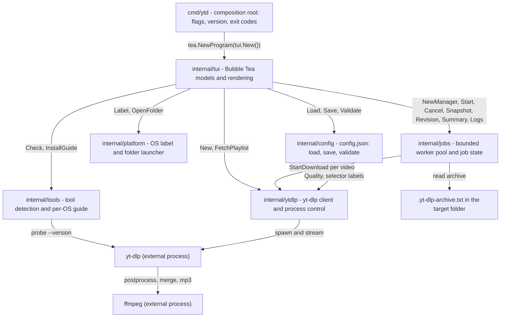
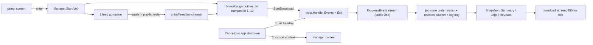
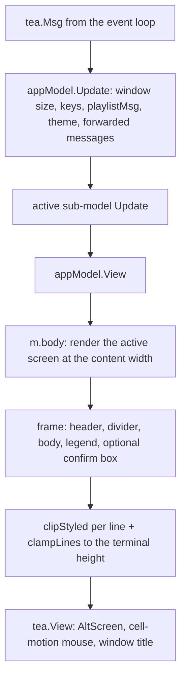

# Architecture

This document describes the structure of lhi-youtube-downloader as implemented: package boundaries and import direction, the responsibilities and key types of every package, the concurrency and process model, the rendering pipeline, the testing strategy and the repository-wide engineering rules. Read it before making structural changes; `README.md` covers usage and day-to-day development.

## Layers at a glance

The program is a single binary built from `cmd/ytd`. It is a terminal UI on top of a thin yt-dlp client, with no server, no database and no network code of its own: everything that touches YouTube goes through the external yt-dlp and ffmpeg binaries.

Import direction is acyclic and one-way:

| Package | Imports (internal) | Imported by |
| --- | --- | --- |
| `cmd/ytd` | `internal/tui` | (module root) |
| `internal/tui` | `config`, `jobs`, `platform`, `tools`, `ytdlp` | `cmd/ytd` |
| `internal/jobs` | `ytdlp` | `tui` |
| `internal/config` | `ytdlp` (the `Quality` type) | `tui` |
| `internal/ytdlp` | (none) | `tui`, `jobs`, `config` |
| `internal/tools` | (none) | `tui` |
| `internal/platform` | (none) | `tui` |
| `scripts/checklines` | (none) | tooling only |

`internal/ytdlp` is the only package that spawns child processes, with one exception: `internal/platform` starts a detached file-manager launcher on the summary screen.

## Package reference

### cmd/ytd

**Files:** `cmd/ytd/main.go`

The composition root. It owns the command-line surface (`-version`, `-help`/`-h`), the version resolution chain and the process exit codes, and it wires the TUI into Bubble Tea. It contains no business logic.

Key symbols: `run(args []string) int`, `resolveVersion() string`, the `version` package variable and the `usageText` constant.

Contracts worth preserving:

- `-X main.version=...` is a release contract; the variable is deliberately named `version` in package `main` and release builds set it with `go build -ldflags "-X main.version=1.2.3"`.
- Version precedence: the ldflags value, then the main module version from `runtime/debug.ReadBuildInfo` (when non-empty and not `(devel)`), then `devel+<first 12 chars of vcs.revision>`, then `devel`.
- Exit codes: `0` success, `1` the TUI failed to run, `2` usage error. The FlagSet output is discarded so help reaches stdout exactly once and errors reach stderr exactly once.
- After the Bubble Tea program returns, `run` calls `Shutdown()` on the final model when it implements `interface{ Shutdown() }`. Bubble Tea consumes `QuitMsg` and `InterruptMsg` inside its own event loop, so on a SIGTERM, a systemd stop or a non-TTY Ctrl+C the model never runs an exit path; this call is the one that kills the yt-dlp and ffmpeg process trees before the process ends.

### internal/config

**Files:** `internal/config/config.go`, `internal/config/validate.go`, `internal/config/config_test.go`

Owns the on-disk settings schema and everything around it: default resolution, loading with graceful fallback, atomic saving, and OS-independent validation and normalization. `Config` doubles as the JSON schema; the struct tags are the exact keys in `config.json`.

Key symbols: `Config` (fields `PlaylistURL`, `TargetDir`, `Quality`, `FilenameTemplate`, `CookiesBrowser`, `Concurrency`, `RangeStart`, `RangeEnd`), `Default()`, `Path()`, `Load()`, `(Config) Save()`, `(Config) Validate()`.

Design points:

- `Load` returns `Default()` for a missing, unreadable or corrupt file, and a partial JSON document overrides defaults field by field. The one error it can return is `errConfigTooLarge`: a file above the 1 MiB read cap (`maxConfigBytes`) is refused instead of being read into memory, and the caller still receives `Default()` alongside the error.
- `Save` stages the encoded JSON in a temporary file created with `os.CreateTemp(dir, "config-*.tmp")`, so the name is random and a symlink planted at a guessable path cannot redirect the write. The staged file is chmodded `0600`, flushed with `Sync`, and renamed over the target, and it is removed on any failure. Readers never observe a partial file.
- Validation is deliberately portable: the same config must be accepted or rejected identically on Windows, Linux and macOS. A Windows drive prefix (`C:`, `d:`) is refused on Unix too, where it would otherwise pass as an ordinary relative name. The filename-template rules reject absolute, rooted and `..`-containing templates, NUL bytes and templates over 512 characters, and require `%(ext)s`.
- `Validate` normalizes in place: `Concurrency` is clamped to 1-10, negative range bounds become 0, and a set `PlaylistURL` must be an `http(s)` URL with a host.

### internal/jobs

**Files:** `internal/jobs/manager.go`, `internal/jobs/job.go`, `internal/jobs/archive.go`, `internal/jobs/logring.go`, `internal/jobs/manager_test.go`, `internal/jobs/testdata/fakeytdlp/main.go`

A bounded-concurrency orchestrator over the ytdlp client. It takes a pre-selected video list, runs a fixed number of downloads at once, tracks per-job state under a mutex, and exposes thread-safe, immutable snapshots for the TUI. It is the only package that knows about archive files and the log ring.

Key symbols: `Manager`, `Options`, `job` (unexported state), `JobSnapshot`, `Summary`, `Status` (with `StatusQueued`, `StatusRunning`, `StatusMerging`, `StatusDone`, `StatusSkipped`, `StatusFailed`, `StatusCanceled`).

Design points:

- `NewManager` starts no goroutines and touches no files; `Start` is guarded by a `sync.Once` and is the only place workers are spawned.
- The archive is consulted before any process is spawned: `readArchive` parses `youtube <id>` lines and matching jobs are marked `StatusSkipped` without launching yt-dlp. yt-dlp's own archive line (`has already been recorded in the archive`) is also recognized at runtime.
- The log ring is bounded twice: 200 lines, 4096 bytes per line, with incomplete UTF-8 sequences dropped after a byte-level cut.
- `Revision()` is the change-detection contract for polling consumers: monotonically non-decreasing, bumped under the mutex whenever `Snapshot`, `Summary` or `Logs` may have changed. A consumer that sees the same revision can skip copying and redrawing.

### internal/platform

**Files:** `internal/platform/platform.go`, `internal/platform/open.go`, `internal/platform/platform_windows.go`, `internal/platform/platform_unix.go`, `internal/platform/platform_other.go`, `internal/platform/platform_test.go`

Adapts the application to the host OS in the two places where that matters to the UI: a friendly platform label for the setup screen (`Windows (amd64)`, `macOS (arm64)`, `Linux (amd64)`; unknown GOOS values pass through unchanged) and a native launcher for the output folder (`explorer.exe` on Windows, `open` on macOS, `xdg-open` elsewhere).

Key symbols: `Name()`, `Label()`, `OpenFolder(dir)`, `openCommand(goos, dir)`, the `launchFn` test seam.

Design points:

- The launcher is started detached and never waited for: `HideWindow` plus `CREATE_NEW_PROCESS_GROUP` on Windows, `Setpgid` on Unix, so closing or killing the TUI cannot take the file manager down with it. A launch failure is surfaced as a one-line status on the summary screen, not as a crash.
- `OpenFolder` reports only launch errors; whether the directory exists is left to the file manager.

### internal/tools

**Files:** `internal/tools/tools.go`, `internal/tools/version.go`, `internal/tools/guide.go`, `internal/tools/lookup.go`, `internal/tools/lookup_windows.go`, `internal/tools/lookup_unix.go`, `internal/tools/tools_windows.go`, `internal/tools/tools_other.go`, `internal/tools/tools_test.go`

Detects the two external tools and explains how to install them. It is stdlib-only and has no dependency on the rest of the application.

Key symbols: `Status`, `Report`, `Check(ctx)`, `lookPath(name)`, `fallbackPatterns()`, `InstallGuide()`, `parseYtDlpVersion`, `parseFFmpegVersion`.

Design points:

- `Check` probes yt-dlp and ffmpeg concurrently; each probe is bounded by a 10-second timeout so a hung binary can never block the setup screen, and the aggregate `Report` is always fully populated.
- `lookPath` tries `exec.LookPath` first and then the well-known install directories for the host OS, so tools installed by WinGet, pipx, Scoop, Chocolatey, Homebrew, apt, dnf, pacman, snap or Flatpak are found even when the shell `PATH` does not expose them. Only existing directories are probed, duplicates are dropped both within the list and against `PATH`, and a tool reachable only as `./name` is refused (the `exec.ErrDot` strictness is preserved).
- `InstallGuide` renders the install commands for the OS the binary runs on; `guideFor(goos)` makes every variant testable on any machine, with the Linux guide as the fallback for unknown systems because it documents the widest range of package managers.

### internal/tui

**Files:** `internal/tui/app.go` (root model, routing, navigation), `internal/tui/app_view.go` (frame, legends, clamping), `internal/tui/app_cmds.go` (async command constructors), `internal/tui/screen_check.go`, `internal/tui/screen_form.go`, `internal/tui/screen_form_fields.go`, `internal/tui/screen_loading.go`, `internal/tui/screen_pick.go`, `internal/tui/screen_download.go`, `internal/tui/screen_done.go`, `internal/tui/layout.go`, `internal/tui/styles.go`, `internal/tui/help.go`, `internal/tui/progress.go`, `internal/tui/format.go`, `internal/tui/text.go`, `internal/tui/input_style.go`

The whole user interface: six screen models, the frame around them, key legends, theme handling, layout clamping and shared widgets. Every screen is a plain Bubble Tea sub-model; none of them knows about the others.

Key symbols: `appModel` and `New()`, `screen` (`scrCheck`, `scrForm`, `scrLoading`, `scrPick`, `scrDownload`, `scrDone`), `checkModel`, `formModel`, `loadingModel`, `pickModel`, `downloadModel`, `doneModel`, plus `ApplyTheme` / `ThemeIsDark`, `Panel`, `RenderBox`, `Bar`, `MiniBar`, `HelpBar`, `Sanitize`, `Truncate`.

Design points:

- `appModel.Update` records window sizes, routes global keys (`ctrl+c`), playlist results (`playlistMsg`, guarded by screen and sequence number so a superseded fetch is dropped), theme replies, and forwards everything else to the active screen. Navigation between screens is owned by the root model alone.
- `appModel.quit`/`shutdown` cancel the jobs manager on every exit path inside `Update`; the exported `appModel.Shutdown` covers the paths the event loop swallows (SIGTERM, a non-TTY Ctrl+C), and `cmd/ytd` calls it after the program returns. Together they guarantee no download outlives the TUI; exit paths still cannot rely on `tea.Quit` alone, because the Bubble Tea event loop consumes `QuitMsg` before `Update` sees it.
- The pick screen keeps a row cache (`rows`, `lastRowW`) so single-row keys patch one row instead of re-rendering the list, and it separates selection state (`all`, `allSel`, absolute playlist indices) from the filtered projection (`videos`, `selected`, `visible`) so a search filter can never change what gets downloaded.
- The download screen memoizes its frame in `dlViewCache` and only re-samples the manager when `Manager.Revision` moved, so the 250 ms tick is cheap on an idle run.

### internal/ytdlp

**Files:** `internal/ytdlp/client.go`, `internal/ytdlp/args.go`, `internal/ytdlp/download.go`, `internal/ytdlp/playlist.go`, `internal/ytdlp/progress.go`, `internal/ytdlp/scan.go`, `internal/ytdlp/quality.go`, `internal/ytdlp/exec_windows.go`, `internal/ytdlp/exec_unix.go`, `internal/ytdlp/exec_other.go` (plus tests, including `download_args_test.go`, which pins the argv order)

The only package that speaks yt-dlp. It builds argument lists, fetches playlist metadata, parses the machine-readable progress templates, and owns the lifetime of a download process including its process tree.

Key symbols: `Client`, `Video`, `Playlist`, `Quality`, `DownloadOpts`, `Handle`, `ProgressEvent`, `Stage`, `ExitError`, `BuildDownloadArgs`, `FetchPlaylist`, `StartDownload`, `(Handle) Kill`, `ParseProgressLine`.

Design points:

- The argument list and the progress templates are a wire contract with yt-dlp. The two `--progress-template` values in `args.go` produce exactly the `DL|...` and `PP|...` lines that `ParseProgressLine` understands; they must change together, and neither is duplicated outside this package.
- Every download runs one yt-dlp process per video, invoked as `yt-dlp <playlist-url> -I <index>`, so playlist metadata and `%(playlist_index)s` in the filename template stay correct. Every run passes `--ignore-config --no-warnings --no-color --newline --progress-delta 0.25`.
- `StartDownload` returns a `Handle` whose `Events` channel streams parsed progress and whose `Exit` channel carries exactly one value: `nil` on success, an `*ExitError` on failure, or the context error when canceled. The handle is non-nil if and only if the error is nil.
- Parsing is allocation-conscious: `ParseProgressLine` walks the line with `strings.IndexByte` and `strconv.ParseFloat` over substrings, which is why the field slices alias the input (see `progress_bench_test.go`).
- Output scanning is bounded (16 KiB initial buffer, 1 MiB maximum line) and always keeps draining a failing stream so yt-dlp can never block on a full pipe while `Wait` reaps it. Stderr keeps a 40-line ring for error text.
- `ExitError` carries the exit code and the last stderr lines; failures that are not `*exec.ExitError` (a missing binary, for example) keep code `-1`.

### scripts/checklines

**Files:** `scripts/checklines/main.go`

A stdlib-only hygiene guard, run from the repository root (it walks up to the directory holding `go.mod`). It enforces the repository's two global rules and exits `0` when clean, `1` on violations, `2` on usage or I/O errors.

- Every file in the tree must stay at or below 800 lines.
- No `.go`, `.md`, `.yml` or `.yaml` file may contain an em dash (U+2014) or en dash (U+2013).

Directories such as `.git`, `bin`, `dist`, `vendor`, `node_modules`, `.idea` and `.vscode` are skipped, as are generated build and coverage artifacts (`*.out`, `*.prof`), which are git-ignored output rather than repository content. Output paths are relative and use forward slashes so results are identical on every platform.

## Concurrency model

- **Bounded worker pool.** `Start` spawns exactly one feed goroutine and `Concurrency` workers (clamped to 1-10; `Options.Concurrency` values outside that range are clamped, not rejected). Jobs are pushed in playlist order over an unbuffered channel; each worker drains until the channel closes, so a job is never claimed twice.
- **Single mutex, immutable snapshots.** `Manager.mu` guards the job slice, the handle set, the log ring and the revision counter. Consumers never see mutable job state: `Snapshot` returns a deep copy, `Summary` an aggregate, `Logs` a copy of the ring.
- **Change detection.** The revision counter lets the TUI skip work: the download screen copies snapshots only when the revision moved, and the `dlViewCache` frame key includes it.
- **Cancellation order matters.** `Cancel` kills every registered handle first and cancels the internal context afterwards. The kill walks the process tree (`taskkill /T /F /PID` on Windows, `kill(-pid, SIGKILL)` on the process group on Unix) and both mechanisms need the parent yt-dlp process to still exist in order to find its ffmpeg children; canceling the context first would let `os/exec` reap yt-dlp and orphan ffmpeg. A handle registered after the kill snapshot closes the race by checking `m.canceled` and `ctx.Err()` in the same critical section as its registration, and killing itself if cancellation was requested. A download that has already been reaped is never signaled: its pid may belong to an unrelated process by then, so `Handle.Kill` and the context cancel hook only cancel the run context.
- **Outcome rules.** A clean exit (drained events, exit code 0) always resolves to `done` or `skipped`, even if a cancel raced it, because a kill can never produce a nil exit error. A non-nil exit resolves to `canceled` when the context was canceled or the manager was canceled; otherwise `failed` with a bounded one-line error (200 runes).
- **Queued jobs.** Cancellation never leaves a job in limbo: jobs still queued when the feed loop or a worker notices the canceled context are marked `StatusCanceled` under the mutex.
- **Graceful shutdown.** Every in-TUI exit path funnels through `appModel.shutdown`, which calls `Manager.Cancel`; `Cancel` is idempotent and safe on a nil manager, so screens before the first download (where no manager exists) are no-ops. `cmd/ytd` also calls the exported `appModel.Shutdown` on the final model after the Bubble Tea program returns, which covers the paths `Update` never runs (SIGTERM, a systemd stop, a non-TTY Ctrl+C). Combined with the process-tree kills, no yt-dlp or ffmpeg child can outlive the TUI.
- **Bounded waiting.** Each `Handle` sets a 10-second `WaitDelay` and starts a pipe-close watchdog: if a process that escaped the killed tree still holds the output pipes' write ends, the watchdog force-closes both read ends 10 seconds after cancellation, so the scanner goroutines (and therefore `Exit`) cannot block forever.
- **Timeouts.** Tool version probes: 10 seconds each. Playlist fetch: a 180-second context, canceled when the user leaves the loading screen or when the result arrives. Downloads: no per-job timeout; they are bounded by the manager context (which is the app's `context.Background()` until canceled).

### Process lifecycle per OS

| Concern | Windows | Linux and macOS | Other systems |
| --- | --- | --- | --- |
| Spawn attributes | `HideWindow` plus `CREATE_NO_WINDOW` (0x08000000): no console flash | `Setpgid: true`: each child gets its own process group | none (`procAttr` is nil) |
| Process-tree kill | `taskkill /T /F /PID <pid>`, resolved from `%SystemRoot%\System32\taskkill.exe` with a `PATH` fallback | `kill(-pid, SIGKILL)` on the child's process group; `ESRCH` counts as success | `os.Process.Kill` on the direct process only |
| Kill semantics | Best effort: a taskkill that ran but terminated nothing is not an error; only a taskkill that could not launch is | `SIGKILL` is deliberate: it matches the force semantics of the Windows path and does not wait out a graceful shutdown window | Best effort |
| `CommandContext` hook | `cmd.Cancel` calls `killTree` instead of the default single-process kill, plus a 10-second `WaitDelay` | same | same |
| Folder launcher | `explorer.exe` with `CREATE_NEW_PROCESS_GROUP` | `open` on macOS, `xdg-open` elsewhere, with `Setpgid` | `xdg-open` fallback |

The build-tagged files (`exec_windows.go`, `exec_unix.go`, `exec_other.go`, `lookup_windows.go`, `lookup_unix.go`, `platform_windows.go`, `platform_unix.go`, `platform_other.go`, `tools_windows.go`, `tools_other.go`) are the only places where platform-specific syscalls live. Everything else is OS-independent and tested identically on all platforms.

## Rendering pipeline

- **Model-View-Update.** The application uses Bubble Tea v2. `Update` returns a new model plus optional commands; `View` builds a `tea.View` with `AltScreen` enabled, `MouseModeCellMotion` (for wheel events on the pick screen) and a window title. All rendering happens on the single event goroutine, which is why the caches below need no locks.
- **Frame owns geometry.** Screens render their body at a content width that is never wider than the terminal and never exceeds 100 columns; the frame adds the header, divider, blank lines and the key legend, and then clips every line to the terminal width and the block to the terminal height. An oversized body degrades into truncated lines with a visible truncation marker (`more lines hidden`) instead of wrapping the layout apart. Styled lines are clipped with `clipStyled`, which copies ANSI escape sequences verbatim, counts them as zero width and appends a reset when it cut a styled string.
- **Legend from the live model.** `screenHelp` returns the key legend for the active screen; the pick screen switches between list keys and search keys depending on whether the search field owns the keyboard. `HelpBar` drops entries that do not fit and appends an overflow marker.
- **Theme detection.** `Init` requests the terminal background color. When the reply flips the active palette, the app calls `ApplyTheme`, rebuilds both spinners (`Retheme`, because spinner models copy the style they were built with), drops the pick row cache and invalidates the download frame cache, then restarts the visible spinner. Until the terminal answers, the dark palette is active.
- **Revision-gated downloads.** The download screen ticks every 250 ms. On each tick it compares `Manager.Revision` with its own copy and only then copies the snapshot and log tail; when the manager signals completion (`Done`), it takes one final complete sample, stops the tick loop for good and lets the root model switch to the summary.
- **View memoization.** `dlViewCache` stores the last frame under the key `(revision, width, height, elapsed second, spinner frame)`. A frame that differs in none of those cannot render differently, so the comparison replaces a full rebuild. The metrics captured alongside the frame (overall percent, completed count, total) power the window title, so the title bar costs nothing extra to render.
- **Incremental list rendering.** The pick screen caches one rendered string per visible row plus the width the cache was laid out for. Movement keys patch the two affected rows, select-all/none rebuilds the cache, and `View` rebuilds only when the width changed or the cache was never built. Search filtering rebuilds the projection but keeps absolute playlist indices, so toggling a row under a filter toggles the same video the unfiltered list shows.
- **Bounded text.** `Sanitize` strips terminal control characters from external text (tool versions, paths, error text, log lines) before rendering; `Truncate` shortens plain text; the log panel shows only the last 4 non-empty lines from the 200-line ring; job rows and the form's compact layout adapt to the available height.

## Testing strategy

- **Unit tests** live next to each package (`config_test.go`, `quality_test.go`, `progress_test.go` and `exec_unix_test.go` under `ytdlp`, `help_test.go`, `layout_test.go`, `progress_test.go`, `screen_pick_test.go` and `app_redesign_test.go` under `tui`, and so on). They mock at the seams, for example the `platform.launchFn` variable.
- **Integration tests** build deterministic fake executables from `internal/jobs/testdata/fakeytdlp` and `internal/tui/testdata/fakeffmpeg` with `go build` into a temporary directory. The fake yt-dlp is driven by environment knobs (`FAKE_PLAYLIST_EXIT`, `FAKE_SLEEP_MS`, `FAKE_STDERR`, `FAKE_EXIT`), so client, manager, archive and cancellation behaviour is exercised without network access or a real yt-dlp install. If the Go toolchain cannot build the fakes, the test self-skips instead of failing the suite.
- **Headless end-to-end.** `internal/tui/e2e_test.go` drives the real application model returned by `New()` through [teatest](https://pkg.go.dev/github.com/charmbracelet/x/exp/teatest/v2): check, form, fetch, selection, download, summary, and a second resume journey that reuses the config and archive files written by the first. The sandbox mirrors the host's user directories (`%USERPROFILE%` / `%AppData%` on Windows, `$HOME` / `$HOME/Library/Application Support` on macOS, `$HOME` plus `XDG_CONFIG_HOME` on Linux), so the same journeys run on all three operating systems. `-short` is the only switch that skips it.
- **CI matrix** (`.github/workflows/ci.yml`): a `checks` job (gofmt, `go vet`, `checklines`) on Ubuntu; a `test` job matrixed over Ubuntu, macOS and Windows that builds, vets and runs `go test ./... -count=1`, adding `-race` on the non-Windows runners; a `cross-build` job that compiles five release targets (`linux/amd64`, `linux/arm64`, `darwin/amd64`, `darwin/arm64`, `windows/amd64`) with `CGO_ENABLED=0`; and a `lint` job running golangci-lint with the version pinned in the workflow and the linter set from `.golangci.yml` (errcheck, govet, ineffassign, misspell, revive, staticcheck, unused).

## Engineering rules

- **800-line cap.** No file in the repository may exceed 800 lines. `go run ./scripts/checklines` (also `make checklines`) enforces it, and `make check` and CI run it on every change. Large areas are split by responsibility rather than by size after the fact: the form's field metadata lives in `screen_form_fields.go` so both it and `screen_form.go` stay readable in one go.
- **Dash rule.** No em dash (U+2014) or en dash (U+2013) in `.go`, `.md`, `.yml` or `.yaml` files. The same guard enforces it, and `scripts/checklines/main.go` writes its own dash literals as escape sequences so the file satisfies its own rule. Use ASCII hyphens.
- **Formatting and analysis.** gofmt (tabs in Go, two-space indent for Markdown/YAML per `.editorconfig`), `go vet`, and golangci-lint with the pinned version (v2.15.0) must pass.
- **Stdlib first.** The module has exactly three direct dependencies (`charm.land/bubbletea/v2`, `charm.land/bubbles/v2`, `charm.land/lipgloss/v2`); repository tooling such as `scripts/checklines` is stdlib-only and does not shell out. A new dependency needs a strong reason.
- **OS independence.** Anything that can be tested identically on every platform should be: config validation is portable by design, path handling is checked with OS-independent rules, and checklines emits forward-slash relative paths. Platform-specific syscalls belong in build-tagged files only.
- **Documented contracts.** Contracts that other code or release tooling depends on are stated in doc comments where they live: the `-X main.version` build contract in `cmd/ytd/main.go`, the `Revision` polling contract in `jobs.Manager`, the `killTree`-before-cancel rule, and the progress-template wire contract in `ytdlp/args.go`.
- **Conventional Commits** for commit messages.

## Where to change what

| Change | Files |
| --- | --- |
| Add or rename a config field | `internal/config/config.go`, `internal/config/validate.go`, `internal/tui/screen_form_fields.go`, `internal/tui/screen_form.go`, `README.md` |
| Add a screen key or legend entry | `internal/tui/app.go` (dispatch), `internal/tui/app_view.go` (`screenHelp`), the screen model itself |
| Add a quality option | `internal/ytdlp/quality.go`, then the form and README tables |
| Change yt-dlp arguments or progress parsing | `internal/ytdlp/args.go`, `internal/ytdlp/progress.go` (change together), `internal/ytdlp/download_args_test.go` |
| Add a platform-specific behaviour | a new build-tagged file in the owning package, following `exec_windows.go` / `exec_unix.go` |
| Add a repository rule | `scripts/checklines/main.go`, `Makefile`, `.github/workflows/ci.yml`, both docs |
